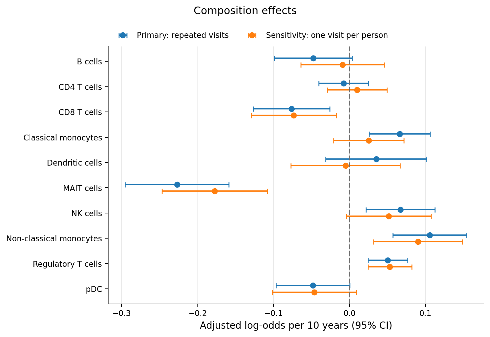
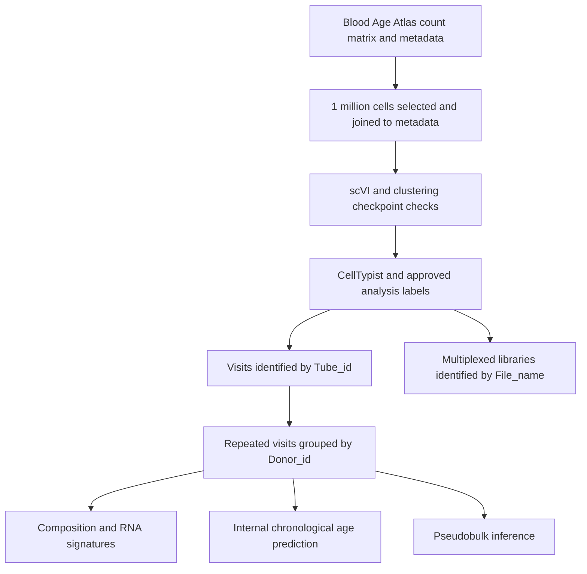

# Immune Aging Single-Cell

How does the cellular composition of human blood change with age, and how much
age information can we recover from single-cell RNA profiles?

This project reanalyzes the Blood Age Atlas using a reproducible Snakemake
workflow. It accounts for repeated blood draws from the same person and
distinguishes cell frequencies, RNA associations, and prediction performance.

[](https://github.com/richard2049/immune-aging-single-cell/actions/workflows/ci.yml)

The source atlas includes **317 visits from 166 people aged 25–85**. The
maintained profile selected **1 million cells** from the deposited PBMC count
matrix. Composition and prediction each used **316 visits from 166 people**.
Eligibility varies by analysis. [Study and data access](docs/real_data.md#blood-age-atlas-inputs)

## Selected results

| Question | Reviewed finding |
| --- | --- |
| Which immune-cell fractions vary with age? | Older age was associated with lower relative MAIT and CD8 T-cell fractions and higher non-classical monocyte and regulatory T-cell fractions. For all four, estimates pointed in the same direction and met a 5% false discovery rate cutoff in both analyses. |
| How accurately can RNA profiles predict chronological age? | Mean absolute error was 12.64 years per visit in internal evaluation. Folds were grouped by person and scVI learned from the full cohort. The paired comparison with Ridge was uncertain. |
| Does a senescence-related RNA score vary with age in CD8 T cells? | A pooled nine-gene score had a positive association in the primary and one-visit analyses. The score measures RNA expression and cannot establish cellular senescence or protein secretion. |



*Composition effects are adjusted log-odds per decade. The estimates describe
relative cell fractions in this cohort. The one-visit check reuses the same
cohort, and both analyses estimate population-level age associations.*

Explore the [age-prediction figure](RESULTS.md#internal-chronological-age-prediction)
and the [CD8 RNA signature figure](RESULTS.md#cd8-t-cell-rna-signature).
The [full results](RESULTS.md) include estimates, intervals, source tables, and
the status of the pseudobulk analysis.

## How the analysis works

The accepted run uses scVI, clustering, and CellTypist, with checkpoint and
annotation review before downstream models. The one-million-cell profile
passed cells through local QC and SOLO stages without additional filtering.



See the [analysis decisions](docs/analysis_decisions.md), [verification contract](docs/verification_contract.md),
and [pseudobulk design](docs/pseudobulk_de_design.md).

## Run the demo

```bash
conda env create -f environment.yml
conda activate immune-aging-scvi
python -m snakemake -s workflows/Snakefile -c 1 --configfile config/demo.yaml
```

PBMC3K tests workflow execution. It lacks the participant and age design needed
for immune-aging inference. See the [runbook](docs/reproducibility.md) for
Windows and GPU setup, real-data rebuilds, output paths, and validation commands.

## Documentation and citation

- [Documentation index](docs/README.md)
- [Data access and metadata](docs/real_data.md)
- [Profiles and method settings](docs/configuration.md)
- [Troubleshooting](docs/troubleshooting.md)
- [Citation metadata for the software release](CITATION.cff)

Original code and documentation use the [BSD 3-Clause License](LICENSE).
External datasets, pretrained models, and third-party software have their
own terms.
