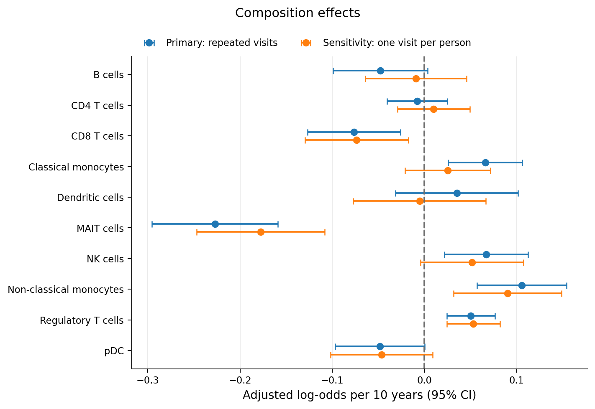
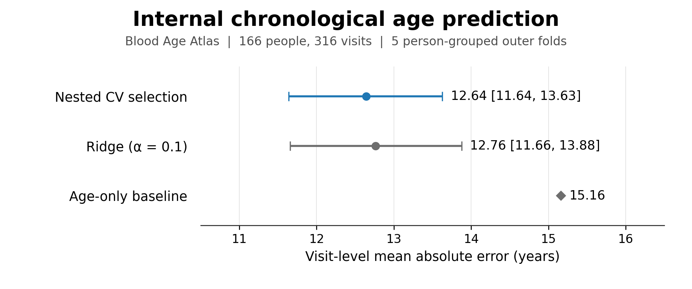
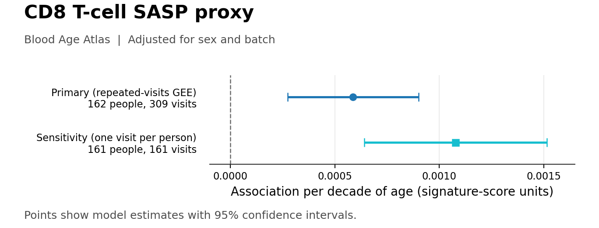

# Blood Age Atlas results

These findings come from the reviewed, subject-aware analysis of the Terekhova
et al. Blood Age Atlas. A visit is a blood-sample unit identified by `Tube_id`.
`Donor_id` identifies the person whose visits may be correlated. `File_name`
identifies a multiplexed technical library. Results describe this cohort.
[Study](https://pubmed.ncbi.nlm.nih.gov/37963457/) · [Methods](docs/analysis_decisions.md)

## Immune-cell composition

**Which relative immune-cell fractions are associated with age?** The primary
binomial GEE adjusts for sex and batch and clusters repeated visits by person.
It includes 316 eligible visits from 166 people. The denominator contains all
999,766 retained cells from those visits, including `Other/unresolved` cells.
The one-visit sensitivity uses the earliest eligible visit per person, with
ties resolved by sample ID. It uses relative cell-count weights and
person-level robust covariance.

Four of ten populations showed the same direction and FDR below 0.05 in both
analyses. Their primary adjusted log-odds differences per decade and 95%
confidence intervals were:

| Population | Estimate | 95% confidence interval |
| --- | ---: | ---: |
| MAIT cells | −0.227 | −0.296 to −0.159 |
| CD8 T cells | −0.076 | −0.127 to −0.026 |
| Non-classical monocytes | +0.106 | +0.057 to +0.154 |
| Regulatory T cells | +0.050 | +0.024 to +0.081 |

Classical monocytes and NK cells met the threshold in the primary analysis
only. Relative fractions can change with the composition of other populations
and cannot establish changes in absolute abundance. The age coefficient
compares observations across the cohort and does not identify a within-person
trajectory or a causal effect.



The points and intervals show the adjusted estimates and approximate 95%
confidence intervals from each model. FDR values for all ten populations are
in the source table. [Composition aggregate](docs/assets/blood_age_atlas_composition_summary.csv)

## Internal chronological age prediction

**How accurately do the RNA-derived features predict visit age within this
cohort?** Five outer folds keep all visits and cell-type rows from a person
together. Inner folds also group by person for model selection. Evaluation
uses one absolute error per held-out visit across 316 visits from 166 people.
The training-age baseline predicts the mean of the training participants’
median ages in each fold. Held-out age labels are used only to score errors.

| Model | Visit-level MAE (years) | 95% participant-bootstrap interval |
| --- | ---: | ---: |
| Nested selection | 12.64 | 11.64 to 13.63 |
| Ridge, α = 0.1 | 12.76 | 11.66 to 13.88 |
| Training-age baseline | 15.16 | — |

The Ridge setting had the lowest overall visit-level MAE among Ridge settings
evaluated on the same outer folds. The paired mean difference across those
five folds was **0.13 years** (Ridge minus nested selection, descriptive 95%
fold-bootstrap interval −0.20 to +0.39). This comparison leaves the performance
difference uncertain. scVI learned from the full cohort before splitting, so
this is internal, transductive evaluation. Fully inductive evaluation would
learn the representation on training participants and test on unseen people.



The baseline appears as a point estimate. The separate paired comparison is
in the aggregate table. [Prediction aggregate](docs/assets/blood_age_atlas_age_prediction_summary.csv)

## CD8 T-cell RNA signature

**Is the pooled CD8 RNA score associated with age?** The score combines
normalized, log-transformed expression of nine SASP-related genes in pooled
CD8 T cells, summarized by visit. This is one selected example from 40
signature-by-cell-type tests. Both models adjust for sex and batch. The
primary GEE accounts for repeat visits within people, and the sensitivity
uses the prespecified one-visit rule. For one person, the rule selected an
earlier visit without an eligible CD8 score. A later visit from that person
contributed to the primary model.

| Analysis | Visits / people | Score change per decade | 95% confidence interval | FDR |
| --- | ---: | ---: | ---: | ---: |
| Primary | 309 / 162 | +0.00059 | +0.00027 to +0.00090 | 0.00505 |
| One visit per person | 161 / 161 | +0.00108 | +0.00064 to +0.00151 | 0.000048 |



The intervals show model uncertainty on the signature-score scale. This RNA
proxy cannot establish senescence or protein secretion. In exploratory
decomposition, the observed mix of annotated CD8 groups reproduced most of
the pooled coefficient under both fixed-expression references. The estimated
share and the sign of the remainder depended on the reference.
[CD8 aggregate and source fingerprint](docs/assets/blood_age_atlas_cd8_sasp_summary.tsv)

## Pseudobulk differential expression

The subject-aware `dream` models and one-visit sensitivity passed technical
qualification in eight eligible cell populations. They use visit-by-cell-type
count sums, sex and batch adjustment, and a subject random intercept in the
primary model. Gene- and pathway-level interpretation awaits scientific
review. [Design](docs/pseudobulk_de_design.md) · [Workflow and checks](docs/pseudobulk_de.md)

## Figure and analysis provenance

All three figures use `syn49637038` and the
[one-million-cell](config/blood_age_atlas_1m.yaml) and
[longitudinal](config/blood_age_atlas_longitudinal.yaml) profiles. The archive
tables below are generated outputs. The linked aggregates above are the
portable figure inputs.

| Reviewed result | Accepted source artifact | Correction or analysis revision | Public restoration |
| --- | --- | --- | --- |
| Composition | `age_celltype_trend_stats.csv` with corrected sensitivity covariance | [PR 13](https://github.com/richard2049/immune-aging-single-cell/pull/13) | [PRs 12](https://github.com/richard2049/immune-aging-single-cell/pull/12) and [13](https://github.com/richard2049/immune-aging-single-cell/pull/13) |
| Prediction | `age_pred_metrics.csv` and replayed `age_pred_model_comparison_summary.csv` | [PR 14](https://github.com/richard2049/immune-aging-single-cell/pull/14) | [PR 16](https://github.com/richard2049/immune-aging-single-cell/pull/16) |
| CD8 RNA | `signature_age_associations.csv` | [Longitudinal workflow requalification](https://github.com/richard2049/immune-aging-single-cell/pull/11) | [PR 17](https://github.com/richard2049/immune-aging-single-cell/pull/17) |

SHA-256 for the accepted archive tables:

- Composition trend table · `f3017dff7ef0a693fcbde69f3c3165c4201d233c0fa1fd8d601bf78e649066b0`
- Prediction metrics · `3263b494a3dea3279559ea9f6e4ed0ee2b20718d6f2794474d2816ac6fa4af28`
- Prediction comparison replay · `9e55549981c1078fd0a9899171f61ec7779ca57f54a7583196ee51a5a5e641b6`
- Signature association table · `c58e7427afe9beece52ed5b7875fb0ac7733c88ef788c793362c33c026e366b7`

The approved PNGs are preserved from the restoration. Re-render the plots
from the published aggregates without running the models or accessing study
data. This recreates the quantitative panels, with layout and file bytes
dependent on the rendering code and Matplotlib runtime. The paired prediction
estimate stays in the table because its interval addresses a separate
comparison from the three MAEs shown in the figure.

```bash
python -m src.render_reviewed_figures --out-dir results/reviewed_figure_replay
```

## Scientific roadmap

| Question | What it requires |
| --- | --- |
| Which pseudobulk signals warrant a biological interpretation? | Review the corrected gene-level models and sensitivity evidence before pathway analysis. |
| How stable are the composition and annotation findings? | Use current data to prioritize sensitivity checks and refine selected subtype labels with scientific review. |
| Can the study estimate within-person age effects? | Assess the number, spacing, and age coverage of repeated visits before specifying a model. |
| How well does prediction generalize to unseen people? | Fully inductive validation requires fold-specific representation learning and substantial computation. |
| Do the findings replicate or support a SASP-related phenotype? | An independent cohort can address RNA replication. Protein or functional measurements are needed for orthogonal evidence. |
